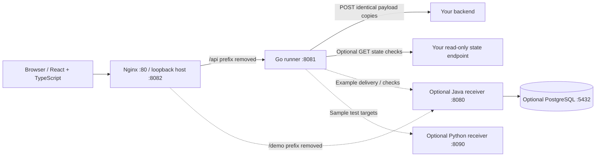
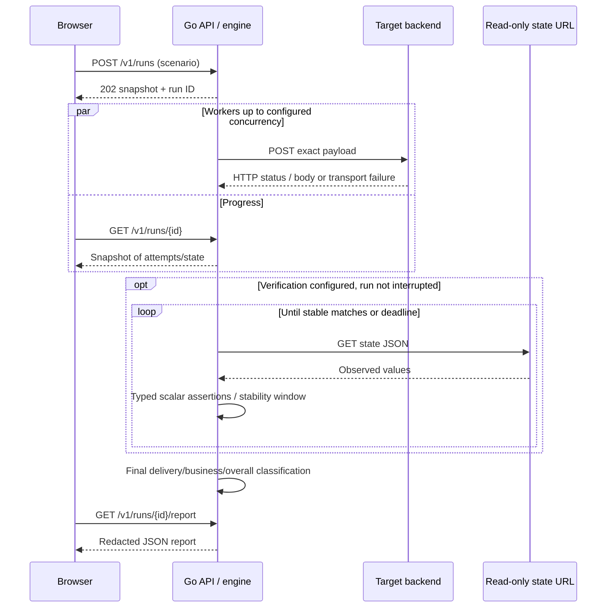
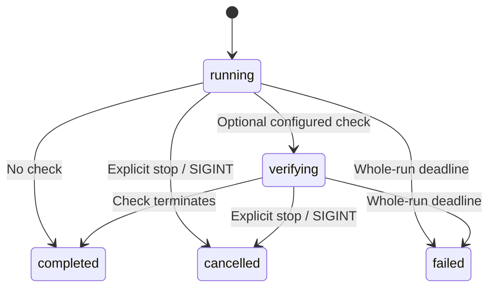
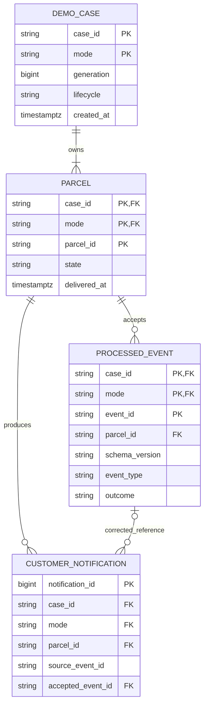

# WebHookProbe architecture and maintenance reference

This is the technical reference for the implemented first release. [README](../README.md) explains normal use; [Sample tests](SAMPLE_TESTS.md) supplies runnable inputs and expected outputs. Source schemas and SQL migrations define exact machine-readable shapes.

## Purpose and boundaries

The system intentionally delivers copies of one POST body and separates two questions:

1. Did the HTTP attempts produce their expected responses?
2. Did explicitly configured observations of the target application satisfy its business expectations?

The generic runner has no parcel logic, database access, target SDK or automatic reset operation. Backend integrations provide a URL, body, headers, delivery settings and optional read-only GET assertions. Each run sends one body unchanged; another payload is another run. Default use requires only the frontend and Go service.

The optional Java parcel receiver makes duplicate business actions visible. The optional Python sample receiver provides deterministic success/failure/latency cases. Neither is required for another application's testing. External email/SMS delivery, production throughput, arbitrary workflows and indefinite exactly-once guarantees are outside this release.

## Components and deployment



| Component | Responsibility | State |
|---|---|---|
| React19 / TypeScript5 / Vite7 | Request/header/check forms; explicit sample setup; polling; result inspection; files | Unsaved form in browser memory; last run/case identity in localStorage |
| Nginx | Static UI; same-origin proxy to Go and optional Java | No application persistence |
| Go1.26 | Strict scenario parsing; bounded delivery workers; timeouts/cancel; state verification; API/CLI/report redaction | One active run, newest plus ten previous reports in process memory |
| Java25 / Spring Boot4.1.1 | Optional faulty/corrected parcel API; lifecycle; transactional state; health/logs | PostgreSQL18 via Spring JDBC / Flyway |
| PostgreSQL18 | Optional demo constraints, event ledger, notifications and lifecycle | Named pgdata volume |
| Python3.13 sample image | Optional deterministic webhook/state/error endpoints | Event IDs and monotonic acceptance time in process memory |

Exact JavaScript dependencies are in package-lock.json; Go/Maven build versions are in their manifests. Docker builds compile source in multi-stage images. Go and Java runtime processes run unprivileged; the sample receiver runs as UID65534. The frontend uses the Nginx image's normal process model.

### Compose modes

| Command | Services |
|---|---|
| `docker compose up -d --build --wait` | frontend, runner |
| `docker compose --profile demo up -d --build --wait` | core + receiver + db |
| `docker compose -f compose.yaml -f compose.samples.yaml up -d --build --wait` | core + Python fixture |
| Combine --profile demo and both files | All five services |

Frontend health and startup depend on the runner, not Java. Its /demo proxy resolves the optional receiver using Docker DNS when requested, so missing demo services do not prevent core startup. A missing optional demo can return502; it does not indicate that generic delivery is unavailable.

Only the web interface is published by the core stack, at127.0.0.1:8082. The sample override publishes fixture8090 on loopback. Java8080, Go8081 and PostgreSQL5432 are internal. compose.dev.yaml optionally publishes DB127.0.0.1:15432 for native development. A different project name creates a separate network/volume for disposable checks.

The runner has host.docker.internal:host-gateway configured for Linux host access. Other target containers must share a Docker network; README includes an external-network override. Browser CORS does not control outgoing delivery because Go, not browser JavaScript, contacts the target. TLS certificates are verified normally. Proxy environment variables are not used by the delivery client.

### Configuration

.env.example lists UI_PORT and optional-demo database/native settings. No environment file is required for stock Docker startup. Compose uses a root .env for interpolation; native Spring Boot does not load that file automatically.

| Variable | Default / role |
|---|---|
| UI_PORT | 8082, loopback web port |
| FIXTURE_PORT | 8090, optional sample host port |
| POSTGRES_USER / POSTGRES_PASSWORD | webhookprobe / webhookprobe-local, local demo only |
| DATABASE_URL | Native JDBC defaults127.0.0.1:15432; Compose supplies db:5432 |
| SERVER_ADDRESS / SERVER_PORT | Native127.0.0.1:8080; Compose sets0.0.0.0:8080 |
| DEMO_ENABLED | Nativefalse; Compose optional receivertrue |

There is no authentication/user isolation in WebHookProbe. Host ports are loopback-published for local operation. Authorization to test a target and application-owned credentials are the operator's responsibility. Public hosting is deferred.

## Browser flow and form model

The interface follows Request → Delivery → Optional result check → Run/results. Optional demo management lives in a collapsed section. Advanced settings hide rarely needed timing knobs. Default request counts/timeouts are real operational values; sample URLs, payloads and empty header/check rows are placeholders only. CSS hides placeholders on focus. Application code never clears populated values on focus and never substitutes placeholder text into a request.

App.tsx owns form/run state; form.ts translates header/check rows to version1 scenarios. HeaderFields and ResultChecks provide structured editing; Results displays independent delivery/business summaries and expected-versus-observed values; DemoPanel performs only explicit demo management.

Import uses parseScenario for browser shape validation; server parsing enforces full execution limits. Unknown top-level fields and malformed check shapes reject. Number checks reject unsafe JavaScript integers; use CLI files for precise larger JSON numbers. Browser rendering of large numeric results is subject to JavaScript number precision; the Go report preserves original JSON number precision.

Run submission POSTs the scenario and records the returned ID. The UI polls every500ms and backs off to2 seconds after errors. A reload reconnects to the saved run or an active run found on the API. Only run/case identifiers are persisted in localStorage, not credentials or form payloads. Stop watching disconnects the UI only; Stop test requests actual cancellation. Prepared ACTIVE cases retain explicit close/abandon controls after reload. Browser storage should not be treated as an authenticated source of authority.

## Request and verification sequence



A request-context disconnect does not cancel an accepted API run: the execution context is detached, with its own cancellation and deadline. A worker pool bounds concurrency. There is no queue across runs; a second active submission conflicts. Every scheduled copy makes one HTTP POST. No redirects, automatic retries or connection reuse/replay are enabled. Individual failures do not stop remaining copies.

Requests carry a per-attempt timeout. The whole run has a120-second budget covering delivery and verification. Stop cancels scheduling and request contexts, but cannot roll back remote commits. Attempts record start time/duration/status(outcome-dependent nullable)/outcome/body preview/truncation. Some requests can be scheduled but interrupted before a response; unstarted counts are reported separately.

Verification begins after delivery attempts settle. It can still run after delivery failures, allowing independent evidence about uncertain remote effects. Each GET has its own timeout and reads at most64KiB. Pointers use RFC6901 syntax: empty pointer selects the root; ~1 decodes /; ~0 decodes ~; array indexes are decimal without leading zeros. Expectations are scalar number/string/boolean/null only. Missing pointer is not JSON null. Numeric equality uses exact rational comparison of Go json.Number values; 1 and1.0 are equal, text"1" is not.

All assertions must continuously match across observed polls for stableForMs. A single mismatch/error resets stability. Polling cannot observe changes between samples or prove correctness after the window. With stableForMs=0, one successful observation suffices. Readable persistent mismatches become failed; unusable/missing/malformed/unavailable data without a proven stable result becomes inconclusive. A total-deadline cancellation is not falsely added as a new state-endpoint error.

## Scenario contract

[scenario.schema.json](../scenarios/scenario.schema.json) describes file shape. Go additionally enforces UTF-8 byte sizes, duplicate keys, unknown fields, header/URL rules and dependent limits. CLI reads at most256KiB+1 before rejecting oversized files. API limits reads equivalently.

```json
{
  "version": 1,
  "name": "Repeated sample event",
  "description": "Optional description",
  "targetUrl": "http://fixture:8090/webhook",
  "headers": {"Content-Type": "application/json"},
  "body": "{\"eventId\":\"example-001\"}",
  "copies": 5,
  "concurrency": 1,
  "timeoutMs": 5000,
  "expectedStatuses": [200],
  "verification": {
    "url": "http://fixture:8090/state/example-001",
    "headers": {},
    "assertions": [{"pointer": "/notificationCount", "equals": 1}],
    "pollIntervalMs": 100,
    "timeoutMs": 5000,
    "requestTimeoutMs": 1000,
    "stableForMs": 500
  }
}
```

version, name, targetUrl, headers, body, copies, concurrency, timeoutMs and expectedStatuses are required. Description defaults empty. Omit verification when unused; explicit null rejects. Verification headers default empty. Body is a raw string, not a nested JSON object: this preserves exact formatting and permits intentional malformed-body tests. The UI builds this string from the payload textarea.

| Constraint | Limit |
|---|---|
| Scenario document | One UTF-8 JSON object; maximum256KiB; strict Go duplicate/unknown-field rejection |
| Name / description | Nonblank name max120 bytes; description max2000 bytes |
| Body | Maximum64KiB; no target-specific shape imposed |
| URL | HTTP(S), hostname required; no URL userinfo or fragment |
| Headers | Up to32; names≤128 bytes; values≤4096 bytes; no CR/LF or duplicate canonical names |
| Transport-owned headers | Host, Content-Length, Transfer-Encoding, Connection, Upgrade, Proxy-Connection reject |
| Copies | 1–1000 |
| Concurrency | 1–min(copies,50) |
| Request timeout | 10–30000ms |
| Expected statuses | 1–100 values, each100–599 |
| Assertions | 1–20, each explicit pointer and scalar equals; pointer≤512 bytes |
| Verification total | 100–30000ms |
| Verification request timeout | 10–total timeout ms |
| Poll interval | 10–5000ms |
| Stability | 0≤stableForMs<total timeout |

Browser JSON import uses the browser parser; duplicate names already collapsed there cannot be recovered. For strict raw-file duplicate-key validation, use the CLI/API parser. The API remains the authority for whether an execution scenario is valid.

## Run state and result classification



No queued state is used. Business outcomes in files are passed, failed, inconclusive, not_configured. While a configured check is pending, the UI says Checking rather than treating it as an omitted check. State completed is independent of the verdict.

| Situation | Overall verdict |
|---|---|
| Any delivery failure or business failed | failed |
| All expected delivery + business passed | passed |
| All delivery expected, verification omitted or inconclusive | inconclusive |
| Explicit cancellation or whole-run deadline | inconclusive, with terminal state cancelled/failed |

The exported report has version, id, state, verdict, startedAt, finishedAt, scenario, attempts, business, scheduled, unstarted, deliveryPassed. business contains outcome, detail, observations and droppedObservations. Partial reports have finishedAt=null and are snapshots, not final evidence. Attempts are sorted by ID after execution; concurrent completion order can differ.

Limits: first4096 response bytes per attempt, verification response64KiB, the latest200 observations with pointer/expected/actual/found/matched evidence. Observed strings truncate at512 bytes; non-scalar actual values use a marker. Older observations are evicted with a dropped count so final observed values remain visible. Synchronized deep-copy snapshots protect shared state; the race detector tests this engine.

The process retains newest plus ten previous reports. Restart loses in-memory history; files explicitly downloaded/written survive. There is no persistent runner database, saved-scenario service or automatic recovery of an executing run after process loss.

### Export privacy

All header values except Content-Type, Accept, X-Demo-Generation and X-Request-ID are redacted. Known sensitive header values, JSON-escaped equivalents and Bearer token fragments are scrubbed from captured text. URL queries are redacted. Redacted credentials must be re-entered; execution rejects [REDACTED] header values. The UI uses equivalent sanitization when exporting settings. This cannot recognize all secrets in arbitrary application bodies: inspect exports before sharing. Neither target payloads nor credentials are intentionally persisted in browser storage.

## Go API

Receiver-relative Go paths below are exposed through /api in Docker/Vite. Error JSON includes status, code and detail. Accepting a run returns a snapshot, not a guarantee that delivery will succeed. Same-origin UI calls preserve Host; mismatched Origin headers receive403. API query parameters are rejected.

| Method/path | Result |
|---|---|
| POST /v1/runs | Scenario →202 report + Location;409 if another active run;422 invalid scenario;415 media;413 oversized;503 shutdown |
| GET /v1/runs/active | 200 active snapshot;204 if idle |
| GET /v1/runs/{id} | 200 report snapshot;404 RUN_UNAVAILABLE after expiry/restart/unknown ID |
| GET /v1/runs/{id}/attempts | 200 attempt array |
| GET /v1/runs/{id}/report | 200 downloadable redacted report; partial allowed |
| POST /v1/runs/{id}/cancel | 202 cancellation acknowledgement; finished runs remain unchanged |
| GET /healthz | 200 process health |

Unsupported route/method combinations return404/405 according to the router. Accepted JSON uses application/json. Unreadable request bodies return400. Outgoing target status codes are report data; they do not become the status code of GET report itself.

## Optional parcel domain and API

A parcel starts IN_TRANSIT and parcel.delivered changes it to DELIVERED. The simulated business action is one customer_notification record. Corrected mode accepts event identities while preventing repeated parcel notifications; faulty mode intentionally bypasses both business protections. Both modes use the same database transaction/lifecycle boundary so reset behavior stays explainable.

Parcel event body is exactly four required strings:

```json
{"schemaVersion":"1","eventId":"evt-001","type":"parcel.delivered","parcelId":"parcel-001"}
```

IDs are1–64 ASCII characters, first alphanumeric, remainder alphanumeric/underscore/hyphen, case-sensitive. There are no optional event fields or occurrence timestamp. Reject missing/null/wrong-type/blank values, unknown/duplicate keys, unsupported version/type, invalid UTF-8/BOM, non-object/multiple JSON values and bodies exceeding16384 bytes including whitespace. Media must be application/json, optional UTF-8 charset; content coding absent/identity. Context belongs in URL/headers, not payload.

Identity is (case_id,mode,eventId). Compare decoded field values, so key order/whitespace/equivalent JSON escapes do not change identity. A schema-valid reused ID with changed content conflicts before lookup of a changed parcel. Invalid payloads reject before lookup or mutation. A different accepted event for an already delivered parcel records ALREADY_DELIVERED without another notification.

### Lifecycle and generation

READY→ACTIVE→CLOSED. Activate is explicit; repeated activation conflicts. Closing ACTIVE seals it; repeated close of CLOSED is an idempotent success. READY cannot close. Close reason COMPLETED/ABANDONED is validated and logged; it does not assert that business checks passed. Reset only READY/CLOSED, clears ledger/notifications/parcel state, increments positive bigint generation, returns READY retaining parcel IDs. ACTIVE reset rejects. Old-generation deliveries/inspection reject after reset; repeat of an old reset also rejects.

Metadata discovery GET deliberately needs no generation so callers can recover after a lost reset response. Do not silently rewrite an old run's captured generation. Generation is returned as a decimal string for TypeScript precision and parsed as positive bigint. Exhaustion requires a fresh case.

### Routes

B means /v1/demo/{mode}/cases/{caseId}, where mode is lowercase corrected/faulty. Browser prefix /demo is removed by the proxy. Native Go targets Java directly without that extra prefix.

| Method/path | Input | Success |
|---|---|---|
| POST /v1/demo/{mode}/cases | caseId and1–10 distinct parcelIds; no generation | 201 {case,parcelIds}, Location header |
| GET B | Empty body; no generation | 200 metadata descriptor |
| POST B/activate | Current X-Demo-Generation; empty body, no Content-Type | 200 ACTIVE descriptor |
| POST B/events | Current generation; four-field event JSON | 200 delivery identifiers and outcome |
| GET B/state | Current generation, empty body | Consistent case-wide counts and sorted parcels |
| GET B/parcels/{parcelId}/state | Current generation | State/counts for chosen parcel |
| GET B/events/{eventId} | Current generation | Accepted payload/outcome/time diagnostic; faulty has no ledger |
| POST B/close | Current generation + {"reason":"COMPLETED"} or ABANDONED | CLOSED descriptor |
| POST B/reset | Current generation; empty body, no Content-Type | {case,parcelIds} with next generation READY |
| GET /actuator/health/liveness | None | 200 while process live; independent of DB |
| GET /actuator/health/readiness | None | 200 only when ready, DB accessible and demo enabled |
| GET /actuator/health | None | Aggregate health |

CaseDescriptor has caseId,mode,generation,lifecycle,createdAt,activatedAt,closedAt,lastResetAt; nullable timestamps are explicit null. CaseState has case,parcels,notificationCount,acceptedEventCount. ParcelState has case/mode/generation/lifecycle/parcelId,state,notificationCount,acceptedEventCount,deliveredAt. DeliveryResult has caseId,mode,generation,eventId,parcelId,outcome. It intentionally omits business counts so a separate snapshot provides evidence. AcceptedEvent adds payload,outcome,acceptedAt. Stored event outcome remains PROCESSED/ALREADY_DELIVERED; duplicate delivery reports DUPLICATE without changing that ledger outcome.

### Error/status catalog

| Status | Codes / behavior |
|---|---|
| 400 | INVALID_JSON, INVALID_REQUEST, INVALID_CONTEXT, INVALID_REQUEST_ID |
| 404 | NOT_FOUND, CASE_NOT_FOUND, PARCEL_NOT_FOUND, EVENT_NOT_FOUND |
| 405 | METHOD_NOT_ALLOWED with Allow |
| 406 | NOT_ACCEPTABLE for unsupported Accept |
| 409 | CASE_EXISTS, GENERATION_MISMATCH, CASE_STATE_CONFLICT, CASE_NOT_ACTIVE, CASE_ACTIVE, EVENT_ID_CONFLICT |
| 413 | PAYLOAD_TOO_LARGE |
| 415 | UNSUPPORTED_MEDIA_TYPE, UNSUPPORTED_CONTENT_ENCODING |
| 422 | PAYLOAD_VALIDATION_FAILED, UNSUPPORTED_SCHEMA_VERSION, UNSUPPORTED_EVENT_TYPE |
| 500 | INTERNAL_ERROR, GENERATION_EXHAUSTED; injected rollback failure uses normal500 error handling |
| 503 | DATABASE_UNAVAILABLE, PROCESSING_TIMEOUT; outcome may be uncertain |

Application errors use application/problem+json with type,title,status,detail,instance,code,requestId. Value validation can add sorted errors and errorsTruncated, capped at20. No rejected raw values/SQL/stack traces are returned. Unknown query/body fields, malformed context and unexpected bodies reject. X-Request-ID is optional but must follow identifier syntax if supplied; otherwise a safe UUID is generated. It is echoed along with Cache-Control:no-store, including application errors. Actuator returns its own compact health JSON, not Problem Details; upstream transport/proxy failures may use different envelopes.

Structured completion logs include requestId,method,status,durationMs,normalized route,case/mode/generation/event context,close reason and stable error code where available. Full bodies, arbitrary headers/credentials and raw queries are excluded. Unexpected failures can have server-side stack traces associated with the request ID.

Demo endpoints are absent unless webhookprobe.demo.enabled=true. Tests explicitly enable the demo profile/property. Disabled routes404, readiness503 and liveness200 are intentional. Fault injection is an injected test-only ProcessingFault implementation, not an HTTP toggle.

## PostgreSQL schema and transaction design

The authoritative DDL is [V1 schema](../receiver/src/main/resources/db/migration/V1__create_demo_schema.sql) and [V2 indexes](../receiver/src/main/resources/db/migration/V2__add_demo_indexes.sql). Flyway applies migrations; clean is disabled. There is no startup sample-data overwrite: explicit preparation creates cases at runtime. Times are timestamptz, UTC connections; IDs use C collation and the probe_identifier domain.



| Table | Important keys/constraints |
|---|---|
| demo_case | PK(case_id,mode); generation>0; mode/lifecycle enums; lifecycle timestamps consistent |
| parcel | PK(case_id,mode,parcel_id); composite FK to case; state/delivered_at consistency |
| processed_event | Corrected mode only; PK(case_id,mode,event_id); composite parcel FK; allowed version/type/outcomes; unique(case_id,mode,event_id,parcel_id) for notification reference |
| customer_notification | Identity bigint PK; composite parcel FK; corrected accepted_event_id must match source_event_id and refer to accepted event for the same parcel; faulty accepted_event_id must be null |

Partial unique index on notification(case_id,mode,parcel_id) WHERE mode='CORRECTED' enforces one corrected action per parcel; faulty duplicates remain possible deliberately. Additional indexes support parcel-scoped notification/event inspection. All foreign keys include case/mode context to prevent cross-case references.

### Corrected delivery transaction

1. Validate HTTP context and payload outside business mutation.
2. Begin READ_COMMITTED write transaction; acquire case row FOR UPDATE.
3. Check case exists, generation matches and lifecycle ACTIVE.
4. Find accepted event ID. Same decoded values→return DUPLICATE without mutation; changed content→409 conflict.
5. For a new ID, require a known parcel. Record accepted event with outcome PROCESSED or ALREADY_DELIVERED.
6. If not already delivered, update state/time and insert one notification in the same transaction. Test-only failure can be injected before notification to prove rollback.
7. Commit before returning success. Ledger/state/notification either commit together or roll back together for a known pre-commit failure.

Per-case serialization coordinates independent events, duplicate checks, reset and close. The unique notification constraint is a further database invariant. Different cases use different row locks. This is an explainable local correctness design, not a high-throughput receiver benchmark.

Faulty mode uses the same transaction/case lock but omits the accepted-event ledger and one-time business guard; it inserts a notification for every successful delivery. Sequential as well as concurrent duplicates therefore reproduce the problem reliably.

Lock timeout1 second, statement timeout2 seconds, transaction timeout3 seconds; JDBC pool size16, connection acquisition timeout1 second. Database failures map to503, invariant failure to500. A dropped commit/response can leave the client uncertain; do not promise rollback for every transport/DB error. Explicit redelivery of the same ID lets corrected mode recognize a committed event.

Read-only inspection uses REPEATABLE_READ so multi-query counts/parcels form one consistent snapshot. Reset takes the same case lock, refuses ACTIVE, deletes notifications before ledger, clears parcel state and increments generation atomically. No shared startup seed or global reset couples otherwise independent test cases.

### Reset example

After delivery/verification stop, use the actual case ID and generation. The browser proxy adds /demo:

```bash
case_url=http://127.0.0.1:8082/demo/v1/demo/corrected/cases/YOUR_CASE_ID
curl -sS -X POST "$case_url/close" -H 'X-Demo-Generation: 1' -H 'Content-Type: application/json' --data '{"reason":"COMPLETED"}'
curl -sS -X POST "$case_url/reset" -H 'X-Demo-Generation: 1'
curl -sS "$case_url"
```

Expected: CLOSED, then CaseSetup READY generation"2", then metadata discovery of that generation. Before next delivery explicitly activate generation2 and update scenario headers. Old-generation events/reset requests409. Use ABANDONED to seal a stranded case only after stopping/abandoning external work.

## Native development and CLI

Native requirements: full JDK25 (java and javac both25), Go1.26+, Node22.12+ with npm, PostgreSQL18 for Java tests/demo. If only a Java25 runtime is installed, compilation fails: a JRE is not a JDK. Set JAVA_HOME and PATH consistently.

```bash
export JAVA_HOME=/usr/lib/jvm/java-25-openjdk-amd64
export PATH="$JAVA_HOME/bin:$PATH"
java -version
javac -version
```

Start the native database with `docker compose -f compose.yaml -f compose.dev.yaml up -d db`. In separate terminals:

```bash
(cd receiver && ./mvnw spring-boot:run -Dspring-boot.run.profiles=demo)
(cd runner && go run ./cmd/webhookprobe serve)
(cd frontend && npm ci && npm run dev)
```

UI runs at127.0.0.1:5173; Vite removes /api and /demo prefixes to Go127.0.0.1:8081 / Java127.0.0.1:8080. Generic native use needs only Go/UI; omit DB/Java. A native runner reaches a loopback-only target at its normal127.0.0.1 address. For the native parcel example, change its connection settings to127.0.0.1:8080 before preparing.

Build the CLI from runner:

```bash
go build -o bin/webhookprobe ./cmd/webhookprobe
./bin/webhookprobe run -scenario ../scenarios/concurrent.json -out report.json
./bin/webhookprobe serve -listen 127.0.0.1:8081
```

The static example files target the Docker sample service name fixture. Before using them with a native CLI, change targetUrl/verification.url to host127.0.0.1:8090, or generate host-compatible files:

```bash
python3 scripts/sample_cases.py generate --fixture http://127.0.0.1:8090 --output .local/native-samples
```

Exit0 verified pass;1 delivery/business failure;2 input/output/setup failure;3 unverified/inconclusive;130 cancellation. Use a compiled executable to preserve codes; go run wraps nonzero exits. Output defaults stdout or -out, created with mode0600. SIGINT/SIGTERM cancel; server shutdown closes admission and drains within5 seconds. CLI runs do not appear in a separate API process's history.

scripts/demo.py is explicit optional setup tooling: prepare creates/activates fresh IDs and writes resolved parcel scenarios; close uses the printed case ID/generation. The generic Go engine never invokes it implicitly.

## Verification and continuous integration

```bash
(cd frontend && npm ci)
RUN_RECEIVER_IT=true bash scripts/check.sh
```

This requires the native toolchain plus a disposable PostgreSQL18 database configured by DATABASE_URL/POSTGRES_USER/POSTGRES_PASSWORD. The script runs Java verify/format/Checkstyle, Go formatting/vet/race, frontend build/type/lint. Real database tests are opt-in; skipped tests do not count as executed integration checks. Java tests cover strict parsing, normal/sequential/concurrent delivery, distinct events, identity conflicts, unknown inputs, constraints, reset/generation isolation, controlled rollback/redelivery and disabled demo routes.

For Java tests without a host JDK, use its Docker build stage and a disposable Compose project. With the optional demo DB available on the project network:

```bash
docker build --target build -t webhookprobe-java-check receiver
docker run --rm --network webhookprobe_default -e DATABASE_URL=jdbc:postgresql://db:5432/webhookprobe -e POSTGRES_USER=webhookprobe -e POSTGRES_PASSWORD=webhookprobe-local -e RUN_RECEIVER_IT=true webhookprobe-java-check ./mvnw verify
```

Those are default local demo credentials; use your actual disposable configuration if changed. Never direct destructive test fixtures at valuable application data. The Java build image may download test dependencies on first run.

Browser suite, with the full optional stack running and idle:

```bash
cd frontend
npm ci
npx playwright install chromium
TEST_BASE_URL=http://127.0.0.1:8082 TEST_FIXTURE_URL=http://fixture:8090 npm run test:e2e
```

Tests are serial because one API process admits one active run. TEST_DEMO=false skips Java-example cases for core-only checks; absent TEST_FIXTURE_URL skips fixture tests. Native tests use the Vite default base and native fixture address. Tests exercise normal user entry, placeholder semantics, import/export, redaction, cancellation, partial reports, typed checks, report downloads, reload and mobile overflow. This is not a complete accessibility audit.

The GitHub Actions workflow configures PostgreSQL18, JDK25, Go1.26 and Node22; runs source checks, native services, browser checks and image builds; collects failures. The workflow explicitly grants read-only contents permission. Its actual execution status is available in [GitHub Actions](https://github.com/sheshan1/WebHookProbe/actions); local test success does not establish remote CI success. The project uses the [MIT License](../LICENSE). Repeatable load/resource measurement and external fresh-machine setup feedback also remain separate work.

## Repository layout

- frontend/src: app, typed form mapping, request/check/demo/result components, styling.
- runner/internal/probe: scenario contract, execution/verification engine, HTTP API and tests.
- runner/cmd/webhookprobe: CLI/API process entry point.
- receiver/src: optional Spring API/service, strict boundary parsing, JDBC transactions, migrations, health/logging and tests.
- scenarios: schema and three small complete sample settings files.
- scripts: source checks, explicit parcel setup, optional sample receiver, scenario generator/live workflow checks.
- compose.yaml: two-service default and profiled Java/DB; compose.samples.yaml: optional Python receiver; compose.dev.yaml: native DB port.
- docs: this architecture reference and sample test guide. Generated reports belong in ignored reports/.local/test-results, not the source documentation tree.

## Design limits and deferred work

POST only; HTTP(S) targets; one payload per run; no provider signature generation, automatic retries, out-of-order scenarios, accounts, public hosting, database introspection or remote rollback. One active run is a deliberate local-tool limit, not distributed scheduling. Case-row locking prioritizes an inspectable correctness argument over per-case throughput. Simulated notification records do not provide external email/SMS exactly-once delivery; an outbox/downstream idempotency design would be additional work.

An overall pass proves only the configured HTTP and finite observation checks. Unrelated side effects, asynchronous work outside that window and user-supplied incorrect assertions can escape detection. Always design state checks around the actual business invariant being tested.

## Local verification of this cleanup

On31 October2026, the revised UI passed15 browser cases, including blank/focus-only placeholders, preservation of typed input, form-only backend integration, both cancellation paths, redacted settings, mobile overflow and all six parcel comparisons. Java verification passed11 tests with no failures/errors/skips using the full Docker JDK25; unused validation/test starters were removed. Go formatting/vet/race checks passed, including a regression retaining the final matching observation when history is capped. The42-case HTTP workflow verifier passed. The documented host.docker.internal path was verified against a separate synthetic host backend. Production throughput, a complete accessibility audit, external fresh-machine setup and remote CI were not claimed by these checks.


## Pre-publication verification

On 6 November 2026, a fresh clone of committed revision `d87bb4a` started the default Docker stack with only the frontend and runner, without a `.env` file or host language installations. The optional Python fixture also started successfully; a sample run returned HTTP 200 and independently verified `notificationCount = 1`. This checks a clean checkout on the current machine, not a different operating system or a clone authenticated through GitHub.

The frontend pins the transitive development dependency `minimatch` to `11.0.1` through an npm override to address [GHSA-g3hv-75wg-m249](https://github.com/advisories/GHSA-g3hv-75wg-m249). All affected dependency paths in the inspected tree were development lint tooling. The patched dependency set passed a clean `npm ci`, TypeScript/production build and ESLint, with zero findings from `npm audit` at verification time. Remove the override when upstream tooling adopts a patched version and recheck those commands. An audit result is a time-specific dependency check, not a complete security review.
